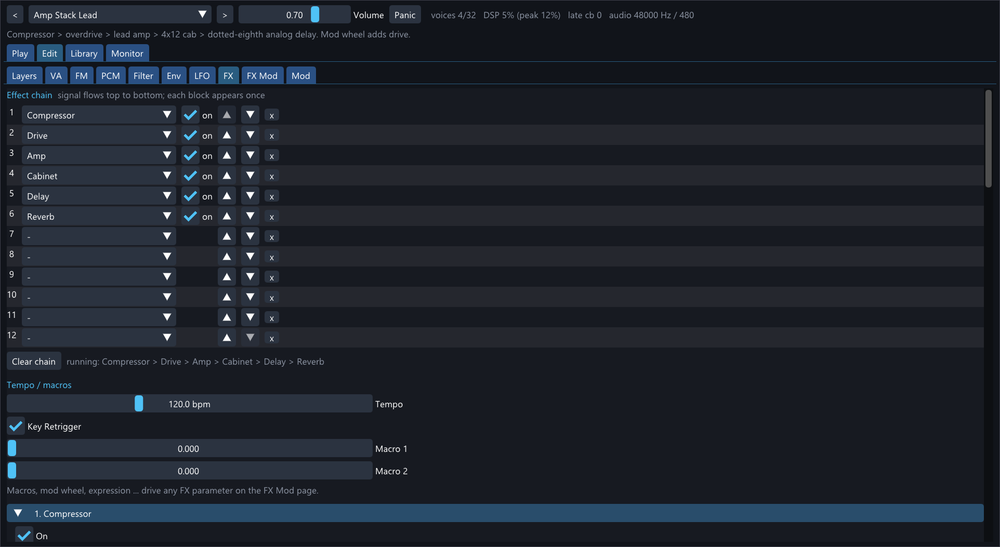

# エフェクトラック（v0.2.0）

HSynth のエフェクトは、31 種類のエフェクトブロックを最大 12 スロットに好きな順で並べる
**エフェクトラック**です（`engine/src/fx/`、`engine/include/hsynth/fx/`）。
参照した 2 つの自作機（REDLINE FX / RP2040-Zero シンセ）が持つエフェクトをすべて含み、
処理はすべて 32bit 浮動小数点・ステレオです。

## 参照機との比較

| 機能 | RP2040 シンセ | REDLINE FX (ESP32-S3) | HSynth |
|---|---|---|---|
| 処理形式 | Q15 固定小数点・モノ・32 kHz | float・モノ・48 kHz | float・**ステレオ**・機器のレート（44.1〜96 kHz） |
| 並び順 | 固定（差し替え可能な設計） | 固定 19 ブロック | **12 スロットの任意順**、ブロックごとに on/off |
| ON/OFF の切替 | 量 0 でバイパス | バイパス | **10 ms クロスフェード**（クリックなし）。ディレイ/リバーブは**残響を残して切替（スピルオーバー）** |
| ゲート / コンプ | コンプ・リミッタ | ゲート、コンプ、リミッタ | ゲート、コンプ（RMS/ピーク、ソフトニー、サイドチェイン HPF、パラレル）、**3 バンドマルチバンドコンプ**、**トランジェントシェイパー**、**ルックアヘッドリミッター** |
| 歪み | OD/Dist/Fuzz | OD/Dist/Fuzz/Metal、2x オーバーサンプリング | 9 種（soft/OD/dist/fuzz/metal/tube/tape/**wavefold**/**rectify**）、tight・bias・クリーンブレンド、**品質設定で 1x/2x/4x** |
| アンプ / キャビネット | — | アンプ 4 種、キャビ 5 種＋ユーザー IR | アンプ 6 種（clean/crunch/lead/higain/modern/bass、多段真空管段＋トーンスタック＋パワー段）、キャビ 8 種＋**ユーザー IR（遅延ゼロの分割畳み込み）**、マイク位置 |
| ローファイ | ビットクラッシャ | ビットクラッシャ | ビットクラッシャ（ジッター付き）、**Lo-Fi（テープのワウ・フラッター、飽和、ヒス、レコードのクラックル）**、**エキサイター（高域＋低域）** |
| EQ / フィルター | 3 バンド、共有 SVF＋EG | 3 バンド、7 バンド GEQ、ワウ | **7 バンドパラメトリック EQ**、**10 バンド GEQ**、マルチモードフィルター（LP/HP 12/24、BP、ノッチ、ピーク、**フォルマント**）＋LFO（テンポ同期）＋**エンベロープフォロワー**、ワウ（手動/オート/LFO） |
| モジュレーション | トレモロ、コーラス、フランジャー | フランジャー、コーラス、フェイザー、トレモロ、ユニヴァイブ、ロータリー、リングモジュレーター | コーラス（classic / **dimension** / **ensemble**、1〜4 ボイス）、フランジャー（**スルーゼロ**）、フェイザー（2〜12 段）、トレモロ / **オートパン** / **ハーモニックトレモロ**、ユニヴァイブ、ロータリー（加減速付き）、リングモジュレーター / **周波数シフター（SSB）**、**キートラック** |
| ピッチ | — | ピッチシフター、オクターバー | **2 声ハーモナイザー**（±24 半音、ボイスごとにパン）、オクターバー（-1 / -2 / +1 オクターブ） |
| ディレイ | フィードバックディレイ | digital/analog/tape/reverse | digital/analog/tape/reverse/**diffuse**、stereo/**ping-pong**/**dual**、**テンポ同期**、**ダッキング**、モジュレーション、ローカット/ハイカット |
| リバーブ | Freeverb 系 | room/hall/plate/shimmer | **8 ラインの FDN**（room/hall/plate/chamber/**cathedral**/**ambience**）、**スプリング**、**シマー**、初期反射、拡散、モジュレーション、**フリーズ**、**IR リバーブ（畳み込み、最大 6 秒、ユーザー IR 対応）** |
| リズム系 | — | スライサー | スライサー（12 パターン、スウィング）、**スタッター（ビートリピート）** |
| ステレオ | — | — | **ステレオイメージ**（width、パン、ハース、低域モノ化） |
| ボコーダー | 8〜12 バンド | — | **4〜32 バンド**、帯域 Q、**フォルマントシフト**、子音（ノイズ）、入力ゲート |
| ルーパー | — | ルーパー（モノ int16） | **ステレオ 60 秒**、録音/再生/オーバーダブ/停止/**アンドゥ・リドゥ** |
| エフェクトの変調 | MIDI CC 直結 | — | **FX モジュレーション 6 スロット**: モッドホイール、LFO2、プレッシャー、エクスプレッション、ブレス、ベンド、ベロシティ、最終ノート、エンベロープ、押鍵中、マクロ 1/2 → 246 個の任意の FX パラメータ |
| テンポ | — | タップ | テンポパラメータ＋**キー・リトリガー**（ディレイ・LFO・スライサー・トレモロが同期） |

## ブロック一覧

パラメータ名は `fx.<キー>.<名前>`（プリセットにも名前で保存）、UI のグループは `FX / <タイトル>`。

| キー | タイトル | 主なパラメータ |
|---|---|---|
| gate | Noise Gate | threshold, range, attack, hold, release（3 dB ヒステリシス） |
| comp | Compressor | threshold, ratio, attack, release, knee, makeup, auto makeup, detector (peak/rms), sidechain HPF, mix |
| mbcomp | Multiband Comp | 2 クロスオーバー（Linkwitz-Riley 4 次）、帯域ごとの threshold/ratio/gain、attack, release, mix |
| transient | Transient Shaper | attack, sustain, speed, output |
| limiter | Limiter | input gain, ceiling, release, look-ahead (0〜5 ms) |
| drive | Drive | type (9), drive, tight, bias, tone, level, mix |
| amp | Amp | model (6), gain, bass, middle, treble, presence, depth, master |
| cab | Cabinet | model (8 + user ir), mic position, low cut, high cut, level, mix |
| crush | Bit Crusher | bits (1〜16, 連続), sample rate, jitter, tone, mix, level |
| lofi | Lo-Fi | wow, flutter, saturation, hiss, crackle, bandwidth, low cut, mix |
| exciter | Exciter | frequency, drive, amount, bass enhance, bass freq |
| peq | Parametric EQ | low cut, low shelf, peak ×3 (freq/gain/Q), high shelf, high cut, output |
| geq | Graphic EQ | 31 Hz〜16 kHz の 10 バンド ±12 dB, level |
| filter | Filter | type (8), cutoff, resonance, drive, LFO (wave/rate/sync/depth), env follow (amount/attack/release), stereo phase, mix |
| wah | Wah | mode (manual/auto/lfo), pedal, sensitivity, rate, resonance, mix |
| chorus | Chorus | mode, voices, rate, depth, delay, feedback, width, mix |
| flanger | Flanger | rate, sync, depth, manual, feedback (±), thru-zero, stereo phase, mix |
| phaser | Phaser | stages (2〜12), rate, sync, depth, center, feedback (±), stereo phase, mix |
| tremolo | Tremolo / Pan | mode (tremolo/autopan/harmonic), wave (7), rate, sync, depth, stereo phase |
| vibe | Uni-Vibe | mode (chorus/vibrato), rate, sync, depth, mix |
| rotary | Rotary | fast, acceleration, drum↔horn, drive, mic spread, mix |
| ringmod | Ring Mod / Shift | mode (ring/freq shift), frequency, key track, LFO rate/depth, stereo spread, mix |
| pitch | Pitch Shifter | voice 1/2: semitone, fine, pan、voice 2 level, window, feedback, mix |
| octaver | Octaver | -1 oct, -2 oct, +1 oct, dry, tone |
| delay | Delay | type (5), mode (3), time, sync, R ratio, feedback, low/high cut, mod depth/rate, ducking, width, mix |
| reverb | Reverb | type (8), size, decay (0.1〜30 s), pre-delay, damping, low cut, diffusion, modulation, width, early, shimmer, freeze, mix |
| convo | IR Reverb | impulse (room/hall/plate/user), pre-delay, low cut, high cut, width, mix |
| slicer | Slicer | division, pattern (12), gate length, depth, smooth, swing |
| stutter | Stutter | hold (repeat), division, reverse, gate, mix |
| stereo | Stereo Image | width (0〜2), pan, haas delay, mono bass below, output |
| vocoder | Vocoder | bands, low/high band, band Q, attack, release, formant shift, sibilance, input gain, input gate, mix |

チェーン全体の設定（グループ `FX Chain`）: `fx.tempo`（20〜300 bpm）、`fx.retrig`（最初のノートで LFO
とリズムを頭出し）、`fx.macro1/2`、`looper.level`、`fx.slot1`〜`fx.slot12`。

## 仕組み

- **パラメータ**: 各ブロックは全体のパラメータ配列の中に連続した領域を持ちます（スロットに入っていなくても値は保持され、
  スロットを移動しても設定は変わりません）。パラメータ数は 222 → **519**。
- **処理**: エンジンの出力（全ボイスの合計）→ スロット 1〜12 → ルーパー → マスター音量 → マスターリミッター。
  32 サンプル単位で処理し、FX モジュレーションもこの単位で反映します。
- **リアルタイム安全**: すべてのメモリは `prepare()` で確保します。ユーザー IR は UI/ローダースレッドで WAV 読み込み・
  リサンプル・FFT 変換までを済ませ、ポインタの差し替えで音声スレッドに渡します（古い IR は `collectGarbage()` で解放）。
- **畳み込み**（`fx/convolver.h`）: 先頭 128 タップを直接 FIR、4096 タップまでを 128 サンプルの FFT 分割、それ以降を
  2048 サンプルの分割で処理します。**追加の遅延はゼロ**で、長い分割の計算は 2048 サンプルの間に均等に分散させ、
  CPU のスパイクを出しません。ステレオ 2 系統を 1 回の複素 FFT で処理します。
- **オーバーサンプリング**: Drive / Amp の非線形部はカイザー窓ハーフバンド FIR で 2x / 4x（DSP 品質 Low=1x、
  Normal=2x、High=4x）。クリーンブレンドは遅延を合わせて混ぜます。
- **ON/OFF**: 通常のブロックは 10 ms のクロスフェードで出し入れします。ディレイ・リバーブ・IR リバーブは OFF に
  すると入力だけを止め、残響は自然に消えるまで鳴らします（スピルオーバー）。
- **キー・リトリガー**: 押鍵がない状態からの最初のノートで、テンポのビート位置を 0 に戻し、スライサー・トレモロ・
  フィルター LFO を頭出しします。遅延線や位相回路を動かす LFO（コーラス、フランジャー、フェイザー、ユニヴァイブ、
  ディレイ）は値が飛ぶとクリックになるため頭出しせず、テンポ同期時は位相をなめらかに引き込みます。
- **旧プリセットの互換**: v0.1 の `chorus.* / delay.* / reverb.* / eq.low / eq.high` は読み込み時に新しいブロックへ
  変換されます（既定のチェーンが旧来と同じ chorus → delay → reverb）。

## 使い方

- **Windows**: Edit → **FX** ページ。スロットのコンボでブロックを選び、▲▼で並べ替え、各ブロックの
  パネルで調整します。Cabinet / IR Reverb は「Load IR (.wav)...」（`library/user/ir` にコピーされプリセットに
  保存されます）。ページ下部にルーパー。**FX Mod** ページで変調元→FX パラメータを割り当てます。
  ボコーダーは Monitor → 「Audio input (vocoder modulator)」をオンにしてマイクを選択します。
- **Android**: Edit → FX / FX Mod ページ（同じ機能。IR は SAF で選択）。ボコーダー用の音声入力は未対応です
  （S23 移植の段階で Oboe の入力ストリームと録音権限を追加します）。
- **デモプリセット** 13〜22: Amp Stack Lead / Ensemble Strings / Rotary Organ / Trance Gate Pad / Shimmer Pad /
  Lo-Fi Keys / Auto-Wah Clav / Vocoder Choir / Jet Flanger Strings / Harmonizer Stutter Lead。

## 検証結果

`hsynth_tests` 52 テスト全合格（うちエフェクト 23 テスト、`engine/tests/test_fx.cpp`）:

- 全 31 ブロック × 既定値 / 全 enum 選択肢 / 最小値・最大値 / ランダム 12 通り / 44.1・96 kHz で NaN なし・発散なし。
  既定値では無音入力後に -80 dB 未満まで減衰（Lo-Fi のヒス・クラックルを除く）
- 測定: パラメトリック EQ +12 dB（誤差 ±0.08 倍）、GEQ -12 dB（±0.5 dB）、コンプ静特性（-15 dBFS ±0.6 dB）、
  リミッター天井、テンポ同期ディレイ（1/8 @120 bpm = 12000 サンプル ±2）、ピッチシフト +12（440 Hz が元の 8 倍以上）、
  周波数シフター（片側波帯、反対側 -30 dB 以下）、リングモジュレーターの側帯波、オクターバー、スライサー周期、
  畳み込み（直接計算との誤差 < 1e-4）、ボコーダー（入力がない間は無音）
- ラック: ON 切替でクリックなし、リバーブ OFF 後も残響継続、モッドホイール → フィルターカットオフ、ルーパー録音・再生・
  クリア、ユーザーキャビネット IR（300 サンプル遅延 IR と一致）、旧プリセット変換と保存・読み込みの往復
- 全プリセット 23 個のオフラインレンダリングで波形の段差（クリック）を検査。見つかった不具合
  （コーラスのリトリガー、マスターリミッターの瞬時アタック）を修正済み
- Windows 版自動テスト（WASAPI 48 kHz / 480 サンプル）: Amp Lead・Trance Gate＋ルーパー・Shimmer を演奏して
  遅延コールバック 0、コールバック負荷ピーク 12〜24 %（3 回実行）

CPU（1 秒のステレオ音声あたり、i5-1135G7 1 コア、既定値）: 大半のブロックは 0.1〜1 %、重いものは
IR リバーブ 1.7 %、Amp 1.25 %、Drive 0.9 %、Reverb 0.9 %、Vocoder 0.7 %。31 ブロック全部を直列にしても 9 %。
32 ボイス + 12 スロット（重いブロック中心）で 10.5 % (Low) / 11.2 % (Normal) / 13.6 % (High)。

## 未検証・制限

- 実際に耳で聴いての音質確認はしていません（数値・波形検査のみ）。特にアンプ / キャビネットの音色と
  ハーモナイザーの音質は調整の余地があります。
- ボコーダーはマイク入力での実演奏を確認していません（テストは信号を直接与えて確認）。
- Android 版の FX 画面は APK のビルドまで確認済み。実機（S23）・エミュレーターでの動作は未確認です。
- MIDI クロックによるテンポ同期は未対応（テンポはパラメータで指定）。
